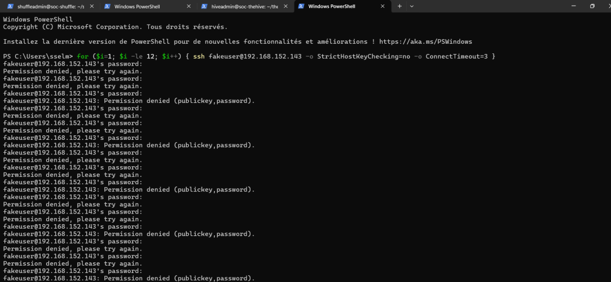
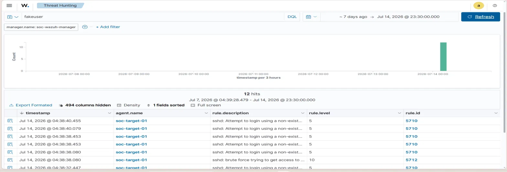
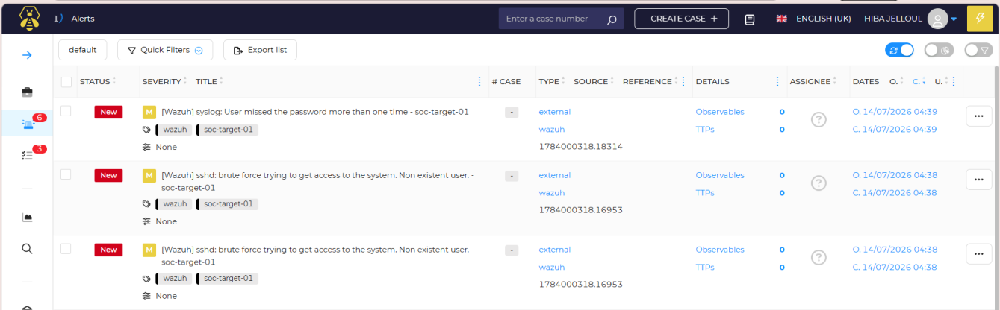
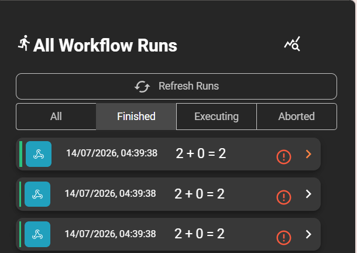
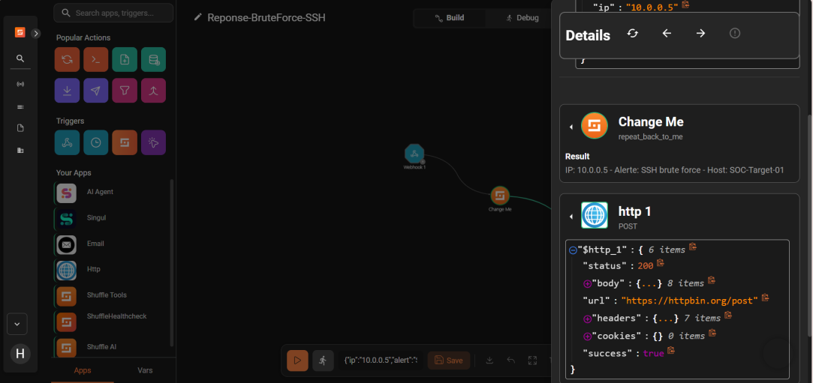

# Mini-SOC : détection d'attaque SSH avec Wazuh, TheHive et Shuffle

Projet réalisé pendant mon stage (juillet 2026) à la Direction des Systèmes d'Information du Ministère de l'Équipement et de l'Eau : un **Mini-SOC open source** qui détecte une attaque par force brute SSH, crée automatiquement une alerte d'incident, puis déclenche une réponse orchestrée, **sans intervention humaine entre les étapes**.

> **Projet éducatif.** Tout s'est déroulé dans un lab virtuel isolé, avec des comptes et des machines de test. L'action de réponse est **simulée** (appel HTTP de démonstration) : elle valide le mécanisme d'automatisation, sans bloquer réellement l'attaquant.

## Objectif

Construire et valider la chaîne complète d'un SOC, de la détection à la réponse :

1. **Détecter** les tentatives de connexion SSH suspectes (SIEM : Wazuh)
2. **Centraliser** l'alerte dans un outil de gestion d'incidents (TheHive)
3. **Automatiser** la réponse (SOAR : Shuffle)

## Architecture

```
 Poste attaquant (Windows, PowerShell)
        │  12 tentatives SSH avec un utilisateur inexistant
        ▼
 soc-target-01 (Ubuntu)  ──agent──▶  Wazuh Manager (SIEM)
                                            │ alerte niveau ≥ 10
                                            │ (script custom-thehive.py)
                                            ▼
                                     TheHive 5 (gestion d'incidents)
                                            │ webhook sur AlertCreated
                                            ▼
                                     Shuffle (SOAR)
                                     workflow « Reponse-BruteForce-SSH »
```

Quatre machines virtuelles Ubuntu Server sous VMware, sur un réseau privé `192.168.152.0/24` :

| Machine | Rôle | Adresse (lab) |
|---|---|---|
| `soc-wazuh-manager` | SIEM Wazuh 4.9.2, tableau de bord | 192.168.152.142 |
| `soc-target-01` | Machine cible avec agent Wazuh | 192.168.152.143 |
| `soc-thehive` | TheHive 5.2 (Docker Compose, Cassandra, Elasticsearch), organisation `Mini-SOC-Stage` | 192.168.152.151 |
| `soc-shuffle` | Shuffle (Docker Compose) | 192.168.152.153 |

## Intégrations mises en place

- **Wazuh → TheHive** : script d'intégration personnalisé `custom-thehive.py` (dans `/var/ossec/integrations/`), déclaré dans `ossec.conf`. Il convertit une alerte Wazuh au format de l'API TheHive. **Seules les alertes de niveau ≥ 10 sont transmises**, pour ne pas saturer TheHive avec les événements normaux.
- **TheHive → Shuffle** : notification sortante `Shuffle-BruteForce-Response`, déclenchée à chaque événement `AlertCreated`, qui appelle le webhook du workflow Shuffle.
- **Workflow Shuffle `Reponse-BruteForce-SSH`** : déclencheur webhook, puis bloc de transformation (Shuffle Tools) qui extrait l'IP, le type d'alerte et l'hôte, puis bloc HTTP POST représentant l'action de réponse.

## Démonstration de bout en bout (test du 14/07/2026)

### 1. Attaque : 12 tentatives SSH avec un utilisateur inexistant
Depuis le poste Windows, 12 connexions SSH sont lancées vers `soc-target-01` avec l'utilisateur fictif `fakeuser` :
```powershell
for ($i=1; $i -le 12; $i++) { ssh fakeuser@192.168.152.143 -o StrictHostKeyChecking=no -o ConnectTimeout=3 }
```


### 2. Détection : Wazuh identifie la force brute
La règle **5710** (*Attempt to login using a non-existent user*, niveau 5) se déclenche 12 fois, puis la règle de corrélation **5712** (*sshd: brute force trying to get access to the system*) est levée au **niveau 10**, soit le seuil d'envoi vers TheHive.


### 3. Alerte : TheHive reçoit automatiquement l'incident
Les alertes *« sshd: brute force trying to get access to the system. Non existent user. »* apparaissent automatiquement dans TheHive (tag `wazuh`, source `external`), sans création manuelle.


### 4. Réponse : Shuffle est déclenché automatiquement
La création des alertes déclenche le workflow `Reponse-BruteForce-SSH` : trois exécutions terminées (*Finished*) à 04:39:38, immédiatement après les alertes.


### 5. Détail de l'exécution du workflow
Le bloc de transformation formate le message (IP, type d'alerte, hôte), puis l'appel HTTP de réponse aboutit (**status 200, success: true**). Cette capture provient de la validation du workflow avec des données de test.


**Résultat :** l'attaque est détectée, transformée en alerte puis traitée par une réponse automatisée en environ une minute, sans aucune intervention humaine.

## MITRE ATT&CK

| Règle Wazuh | Technique | ID |
|---|---|---|
| 5710 / 5712 | Brute Force : Password Guessing | T1110.001 |
| 5710 | Remote Services : SSH | T1021.004 |

## Difficultés rencontrées et solutions

| Problème | Diagnostic | Solution |
|---|---|---|
| Arrêt en cascade des services Shuffle | Disque de la VM saturé (10 Go), OpenSearch passé en lecture seule | Extension du disque à 30 Go, puis de la partition et du volume logique **LVM** |
| Les workflows Shuffle ne s'exécutaient pas | Moteur **Orborus** : mauvaise configuration Docker Swarm, conflits de « leader », puis bug de l'image `latest` (champ *Image* vide), identifié grâce au **mode debug du démon Docker** | Version de l'image Orborus figée et variables d'authentification corrigées |
| Force brute SSH non détectée au premier test | L'agent lisait journald mais ne surveillait pas `/var/log/auth.log` | Ajout de `/var/log/auth.log` dans la configuration de l'agent, puis redémarrage |

## Limites

- Lab avec un seul agent supervisé et des données de test.
- La réponse est simulée (appel HTTP vers un service de test) : pas de blocage réel d'IP ni de désactivation de compte.
- Vérification SSL désactivée sur le webhook TheHive → Shuffle (certificat auto-signé du lab).

## Pistes d'amélioration

- Bloquer réellement l'IP source (pare-feu ou Wazuh Active Response)
- Notifier l'équipe SOC (e-mail, messagerie)
- Enrichir l'alerte (réputation de l'IP) avant la création du cas
- Étendre la supervision à davantage d'agents

## Compétences développées

- **Intégration SIEM, gestion d'incidents et SOAR** : script d'intégration Wazuh → TheHive, seuil de sévérité, webhooks TheHive → Shuffle
- **Détection** : lecture et corrélation des règles Wazuh (5710 → 5712), association à MITRE ATT&CK
- **Administration Linux** : réseau statique, gestion du stockage LVM, configuration d'agent
- **Conteneurisation** : déploiement et dépannage Docker / Docker Compose
- **Résolution méthodique d'incidents techniques** : analyse des journaux, état des services, mode debug, puis correctif ciblé et vérifié

## Auteure

Hiba Jelloul, [github.com/hiba-jl](https://github.com/hiba-jl)
