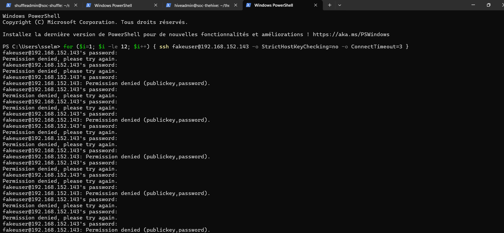
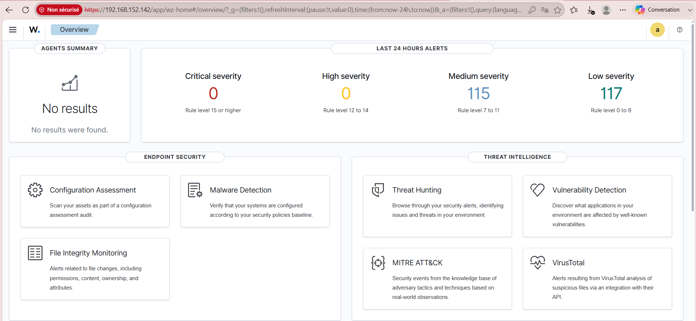
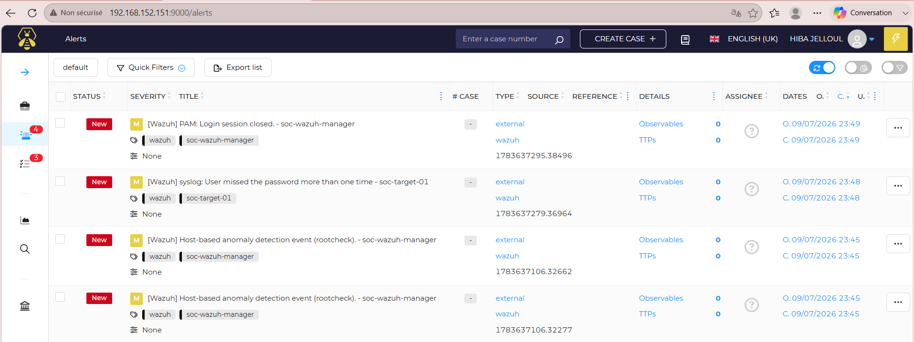
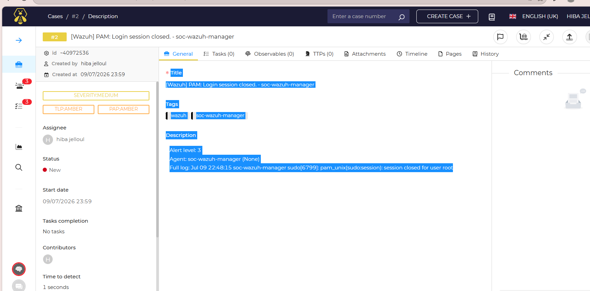
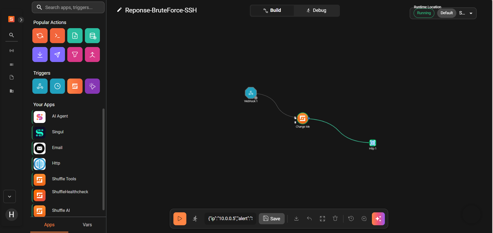

# Mini-SOC : détection d'attaque SSH avec Wazuh, TheHive et Shuffle

Projet réalisé pendant mon stage (juillet 2026) : un petit **SOC de laboratoire** qui détecte une attaque par force brute SSH, crée automatiquement un dossier d'incident, puis déclenche une réponse automatisée.

> **Projet éducatif.** Tout s'est déroulé dans un lab virtuel isolé, avec des comptes et des machines de test. La réponse automatisée est **simulée** : elle ne bloque rien, elle montre le mécanisme.

## Objectif

Mettre en place la chaîne complète d'un SOC, de la détection à la réponse :

1. **Détecter** des tentatives de connexion SSH suspectes (SIEM)
2. **Qualifier** l'alerte dans un outil de gestion d'incidents
3. **Automatiser** une première réponse (SOAR)

## Architecture

```
 Poste attaquant (Windows, PowerShell)
        │  tentatives SSH échouées
        ▼
 soc-target-01 (Ubuntu 22.04)  ──agent──▶  Wazuh Manager (SIEM)
                                                   │ alertes
                                                   ▼
                                           TheHive 5 (gestion d'incidents)
                                                   │ notification webhook
                                                   │ (événement AlertCreated)
                                                   ▼
                                           Shuffle (SOAR)
                                      workflow « Reponse-BruteForce-SSH »
```

| Machine | Rôle | Adresse (lab) |
|---|---|---|
| `soc-wazuh-manager` | SIEM Wazuh 4.9.2, tableau de bord | 192.168.152.142 |
| `soc-target-01` | Cible Ubuntu 22.04 avec agent Wazuh | 192.168.152.143 |
| `soc-thehive` | TheHive 5.2, organisation `Mini-SOC-Stage` | 192.168.152.151 |
| `soc-shuffle` | Shuffle (automatisation) | — |
| Poste Windows | Génère les tentatives SSH | — |

Les adresses sont des IP privées du lab.

## MITRE ATT&CK

| Tactique | Technique | ID |
|---|---|---|
| Credential Access | Brute Force : Password Guessing | T1110.001 |
| Lateral Movement | Remote Services : SSH | T1021.004 |

## Scénario de test

1. Depuis le poste Windows, des connexions SSH sont tentées sur `soc-target-01` avec des comptes inexistants (`utilisateurbidon`, `fakeuser`) :
   ```powershell
   for ($i=1; $i -le 12; $i++) { ssh fakeuser@192.168.152.143 -o StrictHostKeyChecking=no -o ConnectTimeout=3 }
   ```
2. L'agent Wazuh remonte les journaux d'authentification. Wazuh déclenche des alertes comme *« syslog: User missed the password more than one time »*.
3. Les alertes arrivent dans TheHive et peuvent être transformées en cas.
4. TheHive envoie une notification webhook (`Shuffle-BruteForce-Response`) à chaque `AlertCreated`.
5. Shuffle exécute le workflow `Reponse-BruteForce-SSH` : réception du webhook, formatage du message (`IP: 10.0.0.5 - Alerte: SSH brute force - Host: SOC-Target-01`, données de test envoyées manuellement pour valider le workflow), puis requête HTTP POST de test (statut 200).

## Captures d'écran

### 1. Attaque : 12 tentatives SSH depuis le poste attaquant


### 2. Détection : tableau de bord Wazuh


### 3. Qualification : alertes Wazuh reçues dans TheHive


### 4. Investigation : cas créé depuis une alerte


### 5. Réponse : workflow Shuffle déclenché


Les autres captures (agent actif, échecs de connexion, configuration du webhook, résultat de l'exécution…) sont disponibles dans le dossier [`docs/screenshots`](docs/screenshots).

## Limites

- Lab sur un seul agent, avec des données de test.
- La réponse automatisée est simulée (requête HTTP de démonstration) : pas de blocage réel d'IP ou de désactivation de compte.
- Pas de règle Wazuh personnalisée à ce stade.

## Pistes d'amélioration

- Écrire une règle Wazuh personnalisée pour le brute force SSH
- Faire bloquer l'IP source par le workflow (pare-feu ou Wazuh Active Response)
- Enrichir l'alerte (réputation de l'IP) avant de créer le cas
- Ajouter des notifications par e-mail

## Ce que j'ai appris

- Le rôle d'un **SIEM**, d'un outil de **gestion d'incidents** et d'un **SOAR**, et comment ils s'enchaînent
- Déployer un agent Wazuh et lire les alertes de sécurité
- Relier des outils avec des **webhooks**
- Associer une attaque aux techniques **MITRE ATT&CK**
- Documenter un incident de bout en bout

## Auteure

Hiba Jelloul, [github.com/hiba-jl](https://github.com/hiba-jl)
